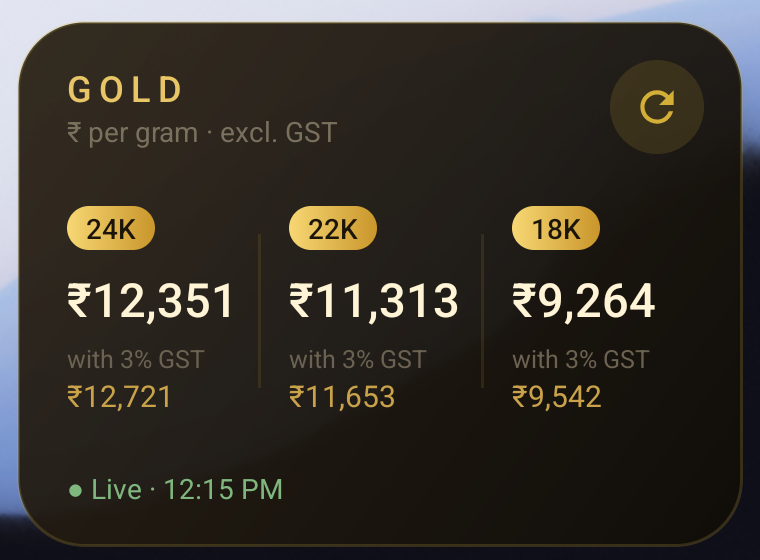

# Gold Rate

Android home-screen widget showing live Indian gold rates for 24K, 22K and 18K per gram, with and without 3% GST.



## How prices are calculated

- Base rates come from [IBJA](https://ibjarates.com), the benchmark Indian jewellers use (999, 916 and 750 purity, published twice a day, excl. GST).
- Between IBJA updates the price follows the live international spot price (XAU/USD) and the USD/INR rate, scaled to the latest IBJA rate.
- 22K and 18K use IBJA's own 916 and 750 rates.

## Features

- Auto refresh every 15 minutes
- Tap ⟳ to refresh instantly
- No API keys, no server, no account

## Install

Download `GoldRate.apk` from [Releases](../../releases), install it, then long-press the home screen → Widgets → Gold Rate.

## Build

Requires JDK 17+ and the Android SDK.

```sh
./gradlew assembleDebug
```
